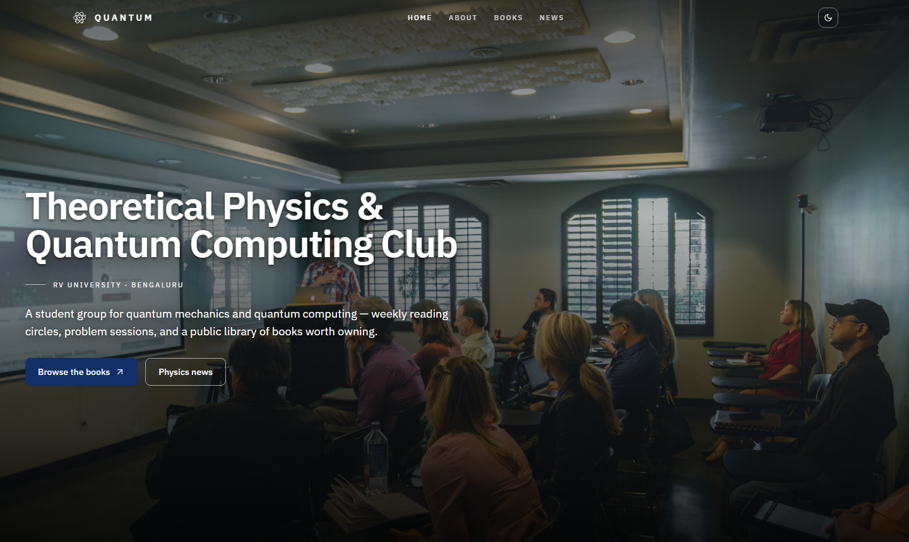

# Quantum

The public website of **Quantum**, the Theoretical Physics & Quantum Computing Club at RV University, Bengaluru.

**Live site:** [quantum-rvu.vercel.app](https://quantum-rvu.vercel.app)



---

## About the site

Quantum is a student reading circle. The site is the club's public face: it explains what the club does, who guides it, which textbooks the members work through, and what is happening in physics right now.

It is a read-only website. There are no accounts, no login and no faculty portal — everything is public and content is edited in the repository.

Four pages:

| Route | Page | What it shows |
| --- | --- | --- |
| `/` | Home | What the club is, how it works, a Bloch-sphere visual for the quantum computing side, the latest physics story and the reading list |
| `/about` | About | How sessions run — weekly reading circle, monthly problem session, termly student seminar — and the three teachers who lead the club |
| `/resources` | Books | A searchable shelf of standard quantum mechanics and quantum computing textbooks, each linked to the publisher |
| `/updates` | News | Recent physics stories from Quanta Magazine, with images and links to the original articles |

A few things worth knowing:

- **Light theme by default**, with a dark theme from the navbar toggle. The choice is remembered in `localStorage`.
- **Motion is subtle** — the hero text rises once on load, and sections fade and lift into view as you scroll. All of it switches off for visitors with `prefers-reduced-motion` set.
- **Content lives in one file** — `frontend/src/data/seed.js` holds the faculty, books and news items. No CMS, no database.
- **Nothing is hardcoded to a screen size** — the layout is built with Tailwind and works from mobile to wide desktop.

---

## Tech stack

| Layer | Choice |
| --- | --- |
| UI | React 19 |
| Build tooling | Create React App with CRACO |
| Routing | React Router 7 |
| Styling | Tailwind CSS 3 |
| Components | shadcn/ui primitives built on Radix UI |
| Icons | lucide-react |
| Type | IBM Plex Sans (Google Fonts) |
| Hosting | Vercel |

---

## Project structure

```
frontend/                 React application (this is what gets deployed)
  public/                 index.html, favicon and static assets
  src/
    components/           navbar, footer, page hero, scroll-reveal wrapper
    context/              theme provider (light/dark)
    data/seed.js          faculty, books and news content
    pages/                Home, About, Resources and Updates
    index.css             Tailwind layers, theme tokens, animations
  .npmrc                  legacy-peer-deps, needed for the dependency tree
  package.json
docs/screenshots/         images used in this README
backend/                  FastAPI stub, not used by the deployed site
```

---

## Run locally

```bash
cd frontend
npm install
npm start
```

The site runs at <http://localhost:3000>.

To check the production build:

```bash
cd frontend
npm run build
```

---

## Deployment

The site is hosted on Vercel at **[quantum-rvu.vercel.app](https://quantum-rvu.vercel.app)** and is connected to this repository. Every push to `main` deploys automatically.

| Setting | Value |
| --- | --- |
| Root Directory | `frontend` |
| Install Command | `npm install` |
| Build Command | `npm run build` |
| Output Directory | `build` |
| Framework Preset | Other — the CRA build runs through CRACO |

Only `frontend/` is built and served. The `backend/` folder is a leftover stub and plays no part in the site.

`frontend/.npmrc` sets `legacy-peer-deps=true` because an unused shadcn calendar primitive depends on `react-day-picker@8`, which declares an older `date-fns` peer range.

---

## Editing content

Open `frontend/src/data/seed.js`:

- `FACULTY` — name, role and portrait of each teacher
- `BOOKS` — title, authors, year, description, publisher link and cover image
- `NEWS` — headline, summary, source, date, category, image and outbound link

Change the arrays, push to `main`, and Vercel redeploys the site.

---

## Contact

quantum@rvu.edu.in
