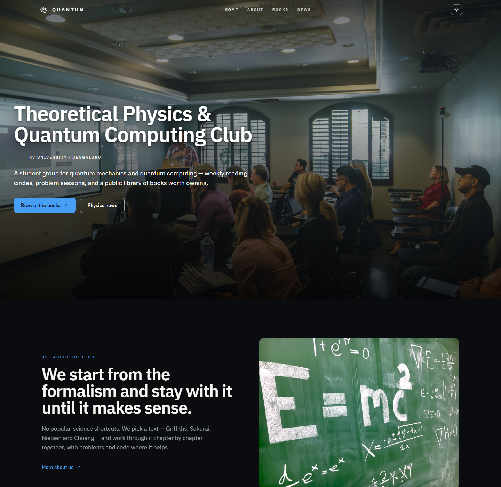
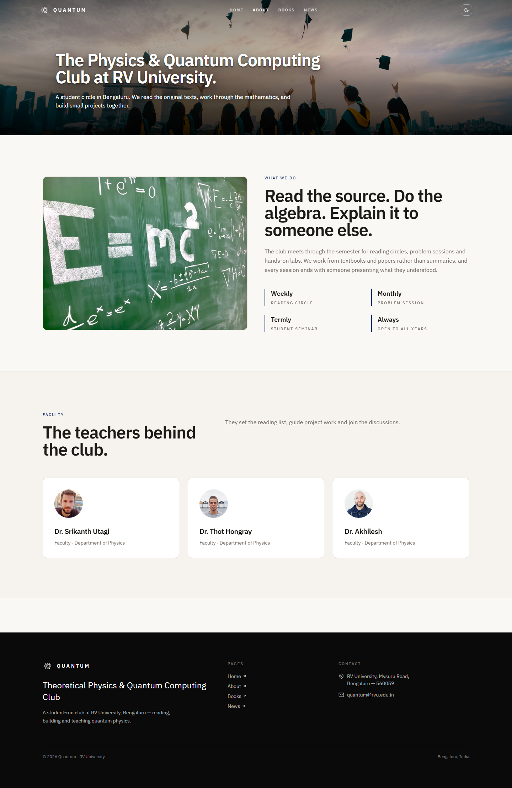
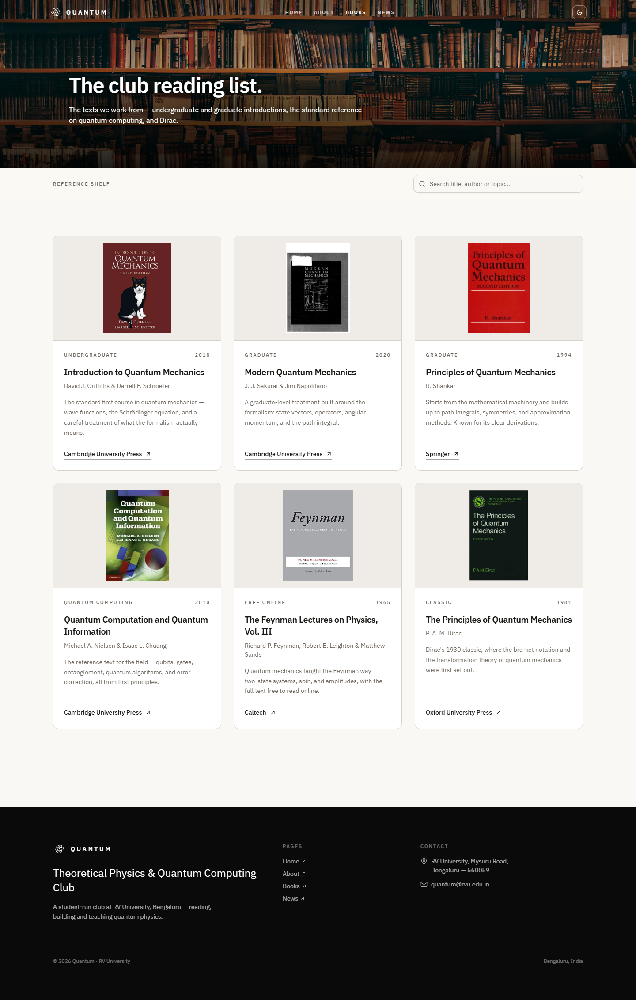
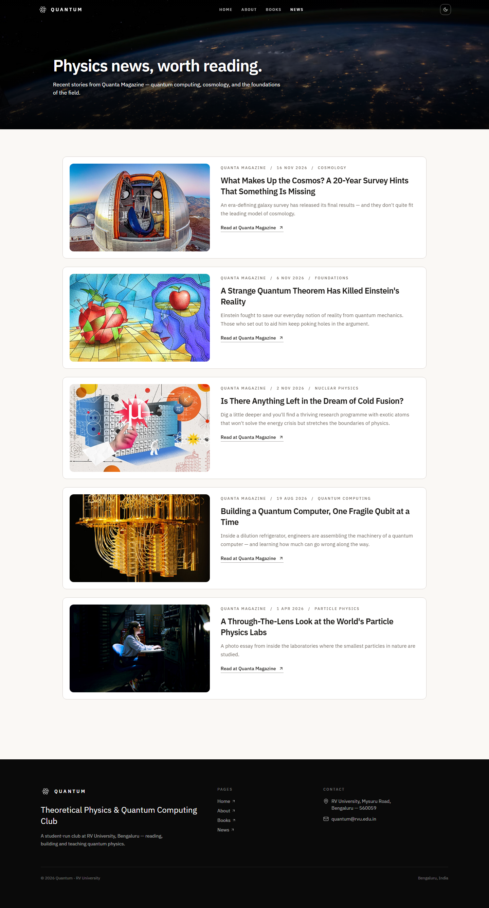

# Quantum

The website for **Quantum**, the Theoretical Physics & Quantum Computing Club at RV University, Bengaluru.

**Live:** [quantum-rvu.vercel.app](https://quantum-rvu.vercel.app)

A public, frontend-only site — no login, no dashboard. It explains what the club does, who runs it, what the reading list is, and what is happening in physics right now.

---

## Screenshots

### Home


The landing page opens on the club's evening reading circle, then walks through how the club works and what members do with qubits.

### Home, dark theme



Light is the default; the toggle in the navbar switches to a dark palette built from layered shades of black so page, sections and cards stay distinct.

### About



Who the club is, how a term runs, and the three teachers who set the reading list.

### Books



The reference shelf — six standard quantum mechanics and quantum computing texts, each linked to the publisher. The list is searchable by title, author or topic.

### News



Recent physics stories, with images and links out to the original reporting.

---

## About the site

Quantum is a student reading circle. The site is written the same way the club works: original texts, real publishers, no filler.

- **Home** — a short statement of what the club is, a section on the formalism-first approach to quantum mechanics, a CSS Bloch-sphere visual for the quantum computing side, the latest physics story, and the reading list.
- **About** — how sessions run (weekly reading circle, monthly problem session, termly student seminar) and the faculty who guide the club.
- **Books** — textbooks the club actually works through, from Griffiths and Shankar to Nielsen & Chuang and Dirac. Every entry links to the publisher.
- **News** — stories from Quanta Magazine covering quantum computing, cosmology, foundations and particle physics.

There is no account system, no faculty portal and no backend required to serve the site. All faculty, book and news content lives in one file, `frontend/src/data/seed.js`.

### Craft notes

- **One typeface** — IBM Plex Sans, loaded from Google Fonts, used for headings, body and UI.
- **Light theme by default** with a dark theme available from the navbar toggle. The choice is stored in `localStorage`.
- **Motion with restraint** — hero text rises once on load, and sections fade and lift into place on scroll via an `IntersectionObserver` wrapper. Every animation is disabled when the visitor has `prefers-reduced-motion` set.
- **Photography** is kept on section heroes but shortened on inner pages so the content leads.
- **No layout shift** — images are sized by aspect ratio, and the navbar turns solid as soon as the page scrolls.

---

## Pages

| Route | Page | Purpose |
| --- | --- | --- |
| `/` | Home | What the club is, how it works, latest story, reading list |
| `/about` | About | Sessions, faculty leads |
| `/resources` | Books | Searchable textbook shelf with publisher links |
| `/updates` | News | Recent physics stories with outbound links |

---

## Built with

| Layer | Choice |
| --- | --- |
| UI | React 19 |
| Tooling | Create React App with CRACO |
| Routing | React Router 7 |
| Styling | Tailwind CSS 3 |
| Components | shadcn/ui primitives on Radix UI |
| Icons | lucide-react |
| Type | IBM Plex Sans |

---

## Project layout

```
frontend/                 React application
  public/                 static assets, favicon
  src/
    components/           navbar, footer, page hero, scroll-reveal wrapper
    context/              theme provider
    data/seed.js          faculty, book and news content
    pages/                Home, About, Books, News
docs/screenshots/         images used in this README
backend/                  FastAPI stub, not used by the deployed site
```

---

## Run locally

```bash
cd frontend
npm install
npm start
```

The app runs at <http://localhost:3000>.

To produce a production build:

```bash
cd frontend
npm run build
```

---

## Deployment

The site is hosted on Vercel at **[quantum-rvu.vercel.app](https://quantum-rvu.vercel.app)**, connected to this repository.

| Setting | Value |
| --- | --- |
| Framework preset | Other — the CRA build via CRACO |
| Root Directory | `frontend` |
| Install Command | `npm install` |
| Build Command | `npm run build` |
| Output Directory | `build` |
| Production Branch | `main` |

Any push to `main` triggers a production deployment. Only `frontend/` is built and served; the `backend/` folder is a leftover stub and plays no part in the site.

`frontend/.npmrc` sets `legacy-peer-deps=true` because `react-day-picker@8` (used only by an unused shadcn calendar primitive) declares an older `date-fns` peer range.

---

## Editing content

Everything visible on the site comes from `frontend/src/data/seed.js`:

- `FACULTY` — name, role and portrait for each teacher
- `BOOKS` — title, authors, year, description, publisher link and cover
- `NEWS` — headline, summary, source, publication date, category, image and link

Change the arrays, push to `main`, and Vercel redeploys.

---

## Contact

quantum@rvu.edu.in
